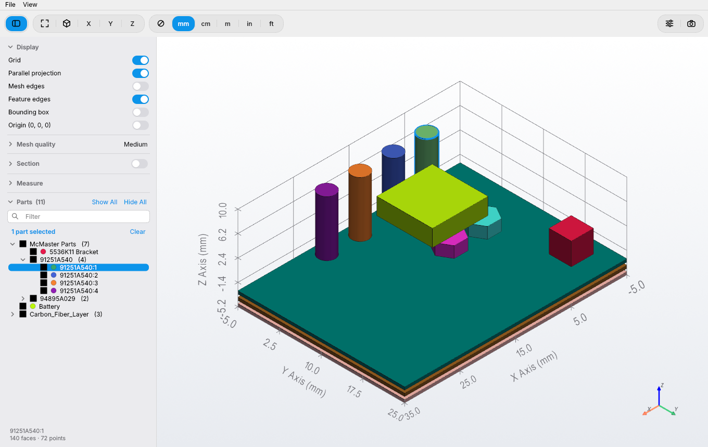

# Mesh Viewer

A fast, native-feeling macOS viewer for **CFD meshes** (CGNS, UGRID) and **CAD
files** (STEP, IGES, BREP, STL, …). Double-click a file and inspect it: show or
hide parts, cut it with a section plane, measure distances, areas and volumes,
and export clean screenshots.



<p align="center">
  
  
</p>

## Features

- **Meshes and CAD in one app**: CGNS and FUN3D/AFLR3 UGRID meshes with their
  named boundaries, and CAD files read with OpenCASCADE, with an adjustable mesh
  quality for STEP/IGES/BREP.
- **Parts list**: groups similar names into fold-out rows, has a filter, and
  checkboxes to show or hide parts. McMaster-Carr parts are collected at the top,
  and right-clicking one gives **Search in McMaster**.
- **Section plane**: set its origin and normal, slide it, flip it, or drag it in
  3D. The cut faces are filled in.
- **Measure**:
  - point-to-point distance, with ΔX / ΔY / ΔZ drawn in 3D
  - area, and volume when the selection is closed
  - **exact** values for STEP/IGES/BREP, straight from the CAD
  - results in mm, cm, m, in or ft; the axis labels follow the same unit
- **Screenshots** at up to 4× the window size, with the background as shown or
  transparent.
- **Looks like a Mac app**: light and dark mode, your accent colour, a sidebar
  with sections that fold, one window per file. A second file opens instantly,
  without starting the app again.
- **Appearance** settings: theme, 3D background (gradient, colour or a picture),
  axis label size, grid and axis lines, edge thickness, and hiding edges while
  rotating for smoother handling of large models.

| Kind | Formats |
|------|---------|
| Mesh | CGNS `.cgns`, UGRID `.lb8/.b8/.lb4/.b4.ugrid` (boundary names from `.mapbc`) |
| CAD, exact geometry | STEP `.step/.stp`, IGES `.iges/.igs`, BREP `.brep/.brp` |
| CAD, triangulated | STL `.stl`, OBJ `.obj`, PLY `.ply`, glTF `.gltf/.glb`, VRML `.wrl/.vrml` |

Native SolidWorks, CATIA, NX, Creo, Inventor, Parasolid (`.x_t`), ACIS (`.sat`)
and JT files are closed formats: export STEP (best) or IGES from those programs.

## Download

Get the latest **`Mesh Viewer <version>.dmg`** from the
[Releases page](../../releases/latest), open it and drag **Mesh Viewer** onto
**Applications**.

> **First launch:** the app isn't notarized by Apple (that needs a paid developer
> account), so macOS blocks it the first time. Try to open it once, then go to
> **System Settings → Privacy & Security** and click **Open Anyway**. You only
> need to do this once.

The app in the .dmg is built for **Apple Silicon** Macs running macOS 13 or later.
On an Intel Mac, build it from source (below).

## Build from source

You need Python 3.12 or 3.13 from Homebrew or python.org. py2app doesn't support
pyenv or conda Pythons, or Python 3.14 yet.

```bash
brew install python@3.13
git clone https://github.com/<you>/MeshViewer.git
cd MeshViewer
./build_app.sh            # quick build, installed in /Applications
```

- `./build_app.sh` creates `.venv`, installs `requirements.txt`, builds the app
  and installs it. This quick build runs the code in this folder, so keep the
  folder where it is. After editing the code, just reopen the app.
- `./build_app.sh --standalone` builds a self-contained app (~1 GB) that can be
  copied to another Mac.
- `./make_dmg.sh` builds the self-contained app, checks it (`--selftest`) and
  packs `dist/Mesh Viewer <version>.dmg`.
- Run without building: `.venv/bin/python mesh_viewer.py file.step`

## Using it

- **Open** files by double-clicking them, dropping them on a window or the Dock
  icon, or with ⌘O. Each file gets its own window.
- **Views**: Fit ⌘0 · Iso ⌘1 · X ⌘2 · Y ⌘3 · Z ⌘4. Press X, Y or Z again to look
  from the opposite side.
- **Select**: click a part, or ⌘/⇧-click to add parts. Click empty space or press
  Esc to clear.
- **Right-click** a part (in 3D or in the list):
  - Hide, Isolate, Zoom To, Show All
  - Search in McMaster (for McMaster part numbers)
  - Right-clicking inside a multi-selection acts on the whole selection.
- **Sidebar**:
  - **Display**: grid, parallel projection, mesh edges, feature edges, bounding
    box, origin marker.
  - **Mesh quality** (STEP/IGES/BREP): five levels; the part is re-meshed in the
    background.
  - **Section**: the plane controls. Switching it on opens them.
  - **Measure**: measuring is on while this section is open.
    - *Distance*: click two points.
    - *Area & Volume*: click parts, or switch to *CAD faces* to pick single faces.
      Clicking empty space clears the faces.
  - **Parts**: list, filter, Show All / Hide All.
- **Units** (toolbar): ⊘ · mm · cm · m · in · ft. Used for measurements and axis
  labels. STEP/IGES files are in mm and get converted.
- **Appearance** (⌘, or the sliders button): theme, parts list spacing, 3D
  background, axis label size, grid lines, axis lines, edge thickness, and hide
  edges while moving.
- **Screenshot** (⇧⌘S): 1×–4× resolution, background *As Shown* or *Transparent*.
- **About Mesh Viewer** is in the app menu.

## Project layout

```
mesh_viewer.py          entry point (+ --selftest)
meshviewer/
  __init__.py           version number
  formats.py            file extension -> reader
  model.py              what readers return: {part name: surface} + kind / format / units
  mesh/  cgns.py ugrid.py           mesh readers
  cad/   occt.py                    OpenCASCADE core: read, name, tessellate, exact area/volume
         step.py iges.py brep.py    exact-geometry CAD readers
         stl.py tessellated.py      triangulated CAD formats
  gui/
    app.py              application: windows, file-open events, Appearance settings, About
    window.py           window: toolbar, menus, loading, drag & drop, screenshots
    scene.py            3D view: parts, edges, grid, views, picking, screenshots
    sidebar.py          side panel; part_tree.py = parts list
    section.py, section_panel.py    section plane and its controls
    measure.py, measure_panel.py    measurements and their panel
    appearance_dialog.py, screenshot_dialog.py, about_dialog.py
    background.py       picture behind the 3D view
    widgets.py, icons.py, style.py  switches, menus, icons, light/dark styling
setup.py                py2app settings: icon, file types
build_app.sh            build (+ install)
make_dmg.sh             self-contained app -> .dmg
fix_bundle.py           repairs Homebrew libraries py2app damages when copying
slim_bundle.py          removes unused Qt parts from the self-contained app
resources/              app icon, .dmg window background
docs/                   screenshots, release notes template
```

The history of every version is in [CHANGELOG.md](CHANGELOG.md).

## Credits

Made by **Matthieu de Fontenay**, built with Claude Opus 5.5.

Built on [PyVista](https://pyvista.org) / [VTK](https://vtk.org),
[Qt for Python (PySide6)](https://doc.qt.io/qtforpython/),
[OpenCASCADE](https://dev.opencascade.org) (via
[cadquery-ocp](https://github.com/CadQuery/OCP)), [h5py](https://www.h5py.org)
and [NumPy](https://numpy.org).

## License

[MIT](LICENSE) © 2026 Matthieu de Fontenay
