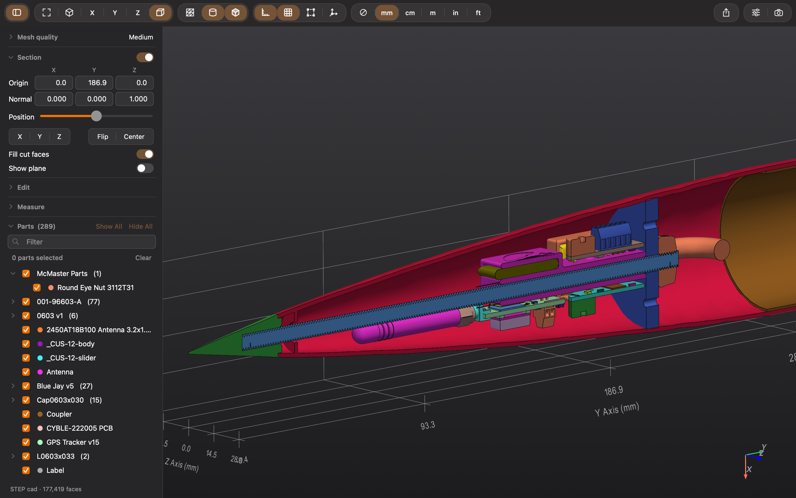
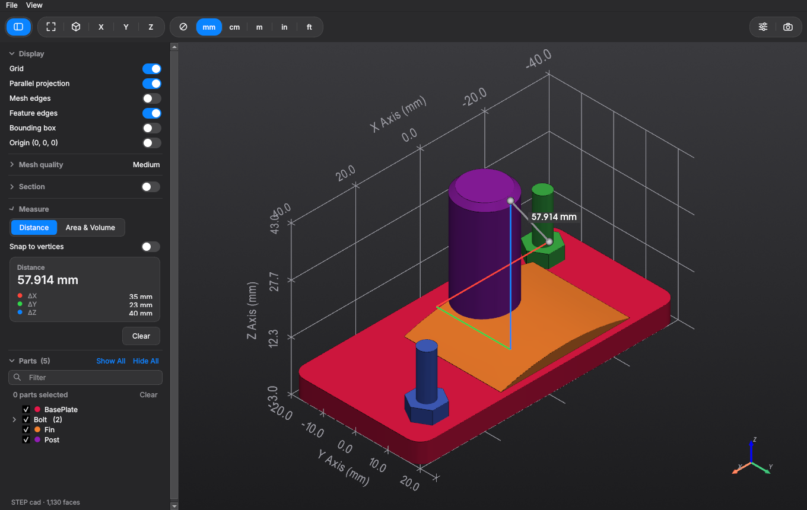
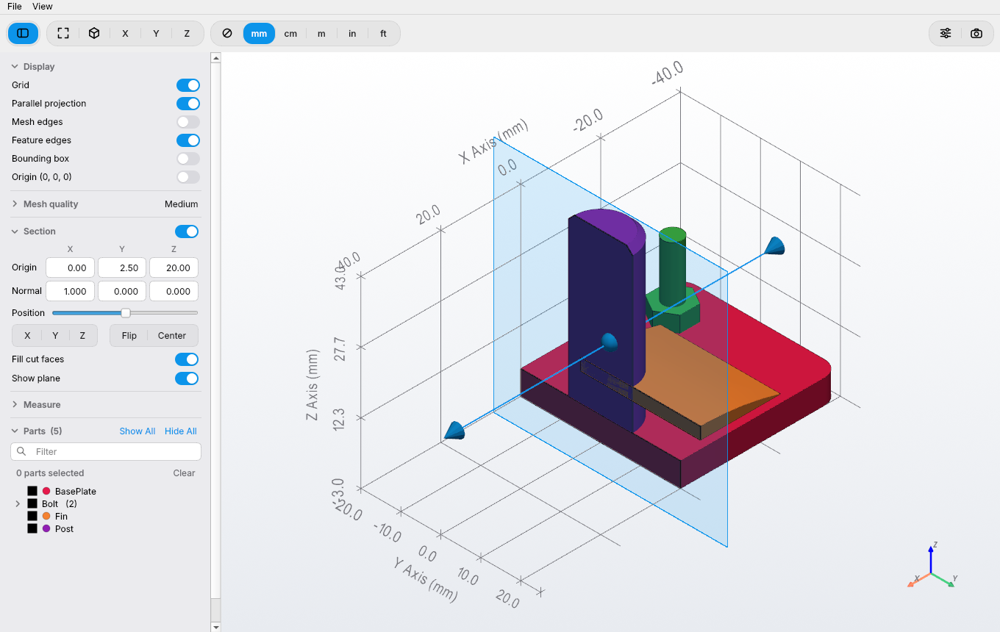
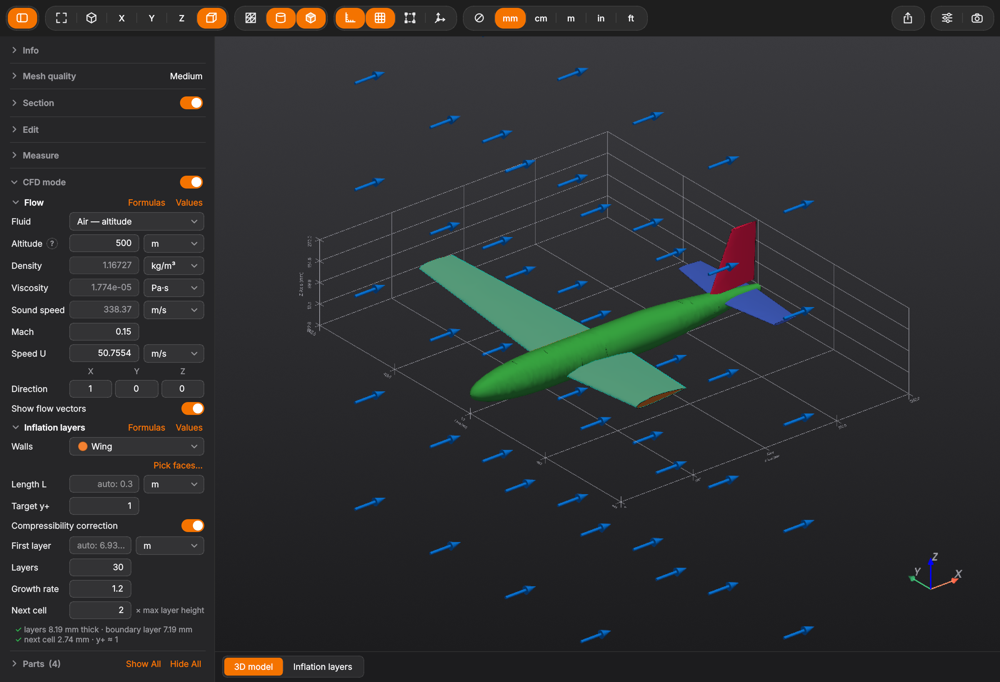
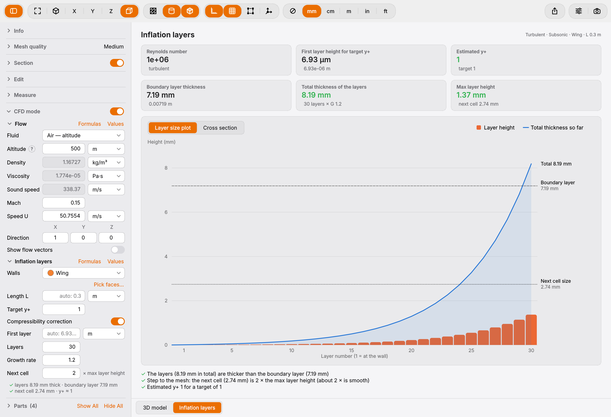
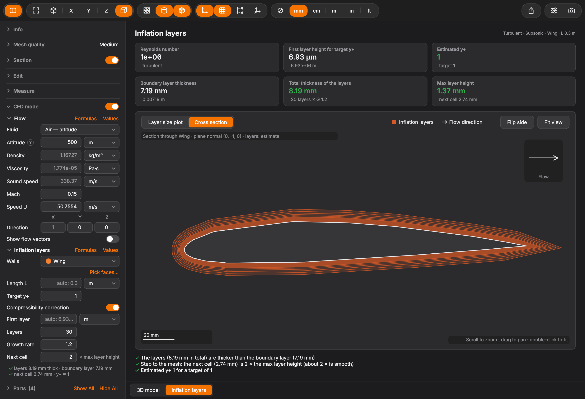

# Mesh Viewer

A fast, native-feeling macOS viewer for **CAD files** (STEP, IGES, BREP, STL, …)
and **CFD meshes** (CGNS, UGRID), with **simulation results** from FUN3D
(Tecplot `.dat`). Double-click a file and inspect it: show or
hide parts, cut it with a section plane, measure distances, areas and volumes,
estimate y+ and inflation layers for CFD, and export clean screenshots.



<p align="center">
  
  
</p>

## Small AI Disclamer

I just wanted to make it clear here: I am a mechanical engineer. I have studied
physics and mechanical engineering, not software engineering. Therefore yes, this
program has entirely been made using Claude Opus 5.5. I was tired of not having
a quick and simple way to preview my CAD/mesh files on my MacBook, so I 'made' this
program. I chose each functionalities it should have, but I didn't implement them
myself. I am sharing this work as I liked how it ended up looking and felt like
others could benefit from it.

## Features

- **Meshes and CAD in one app**: CGNS and FUN3D/AFLR3 UGRID meshes with their
  named boundaries, and CAD files read with OpenCASCADE, with an adjustable mesh
  quality for STEP/IGES/BREP.
- **McMaster Parts list**: groups similar names into fold-out rows, has a filter, and
  checkboxes to show or hide parts. McMaster-Carr parts are collected at the top,
  and right-clicking one gives **Search in McMaster**.
- **Section plane**: set its origin and normal, slide it, flip it, or drag it in
  3D. The cut faces are filled in.
- **CFD** (meshes): y+ estimate on a boundary from the flow (air at an altitude,
  water at a depth, or your own values) and the mesh's first cell layer; the
  boundary **colored by y+**; first cell height for a target y+; compressibility
  correction; a temperature input for water; a unit menu on every input; flow direction arrows.
- **Inflation Layers** (CAD, in the CFD tool): an inflation layer calculator — choose the walls (a part, or
  faces you pick), get the first layer height for a target y+, the layer heights
  for N layers and a growth rate, and compare them to the boundary layer. A page
  under the 3D view shows the **layer sizes** and a **section** of the walls
  with the layers drawn on them (see [CFD tools](#cfd-tools)). External flow or **internal flow** (pipe or duct).
- **CFD export**: the inflation layers as settings for OpenFOAM (snappyHexMesh),
  Fluent Meshing, STAR-CCM+ or Pointwise, or a CSV of every input and value.
- **Which y+?** A **?** next to Target y+ explains resolving the wall (y+ ≈ 1) versus
  wall functions (30 – 300), with a plot of the law of the wall.
- **Formulas** and **Values**: every equation used, shown like LaTeX, and every
  computed number (Re, Cf, δ99, u*…) in a pop-up.
- **Cell quality** (meshes): skewness, aspect ratio, scaled Jacobian and volume of
  every cell, as a histogram; show the bad cells, color the cut by quality, find
  inverted cells.
- **Measure**:
  - point-to-point distance, with ΔX / ΔY / ΔZ drawn in 3D
  - point coordinates (and distance to the section plane), angle between faces
  - area, and volume when the selection is closed
  - **exact** values for STEP/IGES/BREP, straight from the CAD
  - results in mm, cm, m, in or ft; the axis labels follow the same unit
- **Screenshots** at up to 4× the window size, with the background as shown or
  transparent.
- **Works like a Mac app**: the full menu bar (Edit ▸ Undo for every change, Find,
  Window, Help with every keyboard shortcut), light and dark mode, your accent color,
  the parts list on the left and the tools on the right (View · Measure · Analyze
  tabs), a light toolbar you can customize, one window per file with its name and "Edited" in
  the title. A second file opens instantly, without starting the app again.
- **Settings** (⌘,): theme, the meshing control level CAD files open at, 3D background
  (gradient, color or a picture), axis label size, edge thickness, hiding edges while
  rotating, and the units files are shown and assumed in.

| Kind | Formats |
|------|---------|
| Mesh | CGNS `.cgns` (MIXED, polyhedral NGON / NFACE cells too), UGRID `.lb8/.b8/.lb4/.b4.ugrid` (boundary names from `.mapbc`), Gmsh and Fluent `.msh` (2D or 3D, found from the file) |
| Results | Tecplot ASCII `.dat` (FUN3D `project_tec_boundary.dat`: the boundaries with their solution) |
| CAD, exact geometry | STEP `.step/.stp`, IGES `.iges/.igs`, BREP `.brep/.brp` |
| CAD, triangulated | STL `.stl`, OBJ `.obj`, PLY `.ply`, glTF `.gltf/.glb`, VRML `.wrl/.vrml` |
| Drawing (2D) | DXF `.dxf`: lines, arcs, circles, splines and blocks, one part per layer |

Native SolidWorks, CATIA, NX, Creo, Inventor, Parasolid (`.x_t`), ACIS (`.sat`)
and JT files are closed formats: export STEP (best) or IGES from those programs.

## CFD tools

Two sections help set up a CFD mesh:

- **CFD** (for meshes, CGNS / UGRID): checks the y+ of a mesh you already have,
  from its first cell layer, and can paint the boundary by y+.
- **Inflation Layers** (in the CFD tool, for CAD files): plans the inflation layers
  before you mesh. Pick the walls, set the flow and the layers, and switch to the
  **Inflation Layers** page under the 3D view.



<p align="center">
  
  
</p>

The page shows the Reynolds number, the first layer height, the estimated y+,
the boundary-layer thickness and the size of the layers, then two tabs:

- **Layer Sizes**: a bar per layer and the total thickness so far, against
  the boundary layer and the size of the next cell of the mesh.
- **Section**: turn on the section plane (the Section tool) and the cut
  of the walls is drawn in 2D, with the layers on it. It follows the plane as you
  move it. Scroll to zoom, drag to pan. Layers stop where they would cross: in a
  narrow gap they meet half-way, and they stop at other parts.

The settings can then go straight to your mesher: **Export… ▸ CFD Settings**
writes them for OpenFOAM, Fluent Meshing, STAR-CCM+ or Pointwise, or as a CSV.

Below, simple checks say whether the layers cover the boundary layer and step
smoothly into the mesh.

## Simulation results

Open the Tecplot file a solver writes for its boundaries — FUN3D's
`project_tec_boundary.dat` — with File ▸ Open (⌘O). Each boundary becomes a part,
and the inspector opens on **Analyze ▸ Results**: pick a *Field* (any variable in
the file, grouped by subject — Flow, Pressure, Wall… — *Speed*, or *Position X / Y / Z*),
switch on *Color the boundaries*, and the walls are colored
with a scale underneath. *Colors* shows the color maps themselves: pick one
(rainbow by default; also blue–white–red, thermal, gray and blue). The range is the
min to max of the boundaries shown, and follows when you hide or show one; type a
*Min* / *Max* to fix it. Hiding parts and the section plane work as usual, and the
numbers (max · mean · min) are for the visible boundaries.

*Color by ▸ Gradient* colors by how fast the field changes along the surface (|∇f| per
unit length): shocks, leading edges and separation lines stand out.

**Plots** (inspector, Analyze tab, below Results) draw plots, each in
its own tab under the 3D view. *New Plot…* asks for a name and a type — for now
a **section**: the visible boundaries cut by a plane normal to X, Y or Z (type
the position or drag the slider; the cut shows in 3D while the Analyze tab is shown), with cp,
Mach… or the shape (X / Y / Z) plotted along the cut, optionally against x/c, negative
up for cp. *Points ▸ Import…* adds reference points from a CSV (test data, another
solver: the first two numbers of each row), *Export…* saves the plotted points. Each file
remembers its plots and the tab that was open.

Only the ASCII format is read, not the binary `.plt` / `.szplt`: if the solver
writes binary, switch its output to ASCII or re-save the file as ASCII in Tecplot 360.
If the file holds several time steps, the last one is shown.

## Download

Get the latest **`Mesh Viewer <version>.dmg`** from the
[Releases page](../../releases/latest), open it and drag **Mesh Viewer** onto
**Applications**.

> **First launch:** the app isn't notarized by Apple (that needs a paid developer
> account), so macOS blocks it the first time. Try to open it once, then go to
> **System Settings → Privacy & Security** and click **Open Anyway**. You only
> need to do this once.

The app in the .dmg is built for **Apple Silicon** Macs running macOS 13 or later.
On an Intel Mac, build it from source (below).

## Build from source

You need Python 3.12 or 3.13 from Homebrew or python.org. py2app doesn't support
pyenv or conda Pythons, or Python 3.14 yet.

```bash
brew install python@3.13
git clone https://github.com/mdefontenay/MeshViewer.git
cd MeshViewer
./build_app.sh            # quick build, installed in /Applications
```

- `./build_app.sh` creates `.venv`, installs `requirements.txt`, builds the app
  and installs it. This quick build runs the code in this folder, so keep the
  folder where it is. After editing the code, just reopen the app.
- `./build_app.sh --standalone` builds a self-contained app (~1 GB) that can be
  copied to another Mac.
- `./make_dmg.sh` builds the self-contained app, checks it (`--selftest`) and
  packs `~/Downloads/MeshViewer-build/dist/Mesh Viewer <version>.dmg` (its window
  layout is written by `dmgbuild`, installed in the build environment the first time).
- Heavy files (Python environment, app, .dmg) go to `~/Downloads/MeshViewer-build`,
  not the project folder; choose another place with `MESHVIEWER_WORK=/path`.
- Run without building: `.venv/bin/python mesh_viewer.py file.step`

## Already have Python? Run it without the 1 GB app

The self-contained app is big because it carries its own copy of Python, Qt,
VTK and OpenCASCADE (I liked the self-contained aspect). If you already have Python with these packages, you don't
need any of that.

**1. Install what's missing:**

```bash
pip install numpy pyvista pyvistaqt PySide6 h5py cadquery-ocp
```

`cadquery-ocp` is only needed for STEP / IGES / BREP files, and `h5py` only
for CGNS files.

**2. Run it:**

```bash
git clone https://github.com/mdefontenay/MeshViewer.git
cd MeshViewer
python mesh_viewer.py path/to/file.step
```

**Optional: a small app in /Applications that uses your Python.** It gives
you the Dock icon and double-click-to-open, but only weighs a few MB because it
uses your installed packages. This needs Python 3.12 or 3.13 from Homebrew or
python.org:

```bash
python3.13 -m venv --system-site-packages .venv   # reuse your packages
./build_app.sh                                    # quick build, no re-download
```

Keep the MeshViewer folder where it is: this app runs the code from it.

## Using it

- **Open** files by double-clicking them, dropping them on a window or the Dock
  icon, or with ⌘O. Each file gets its own window. An empty window shows the
  **welcome screen**: Open…, your recent files, and two samples to try (the ONERA M6
  wing as a CGNS mesh, an avionics bay as a STEP assembly; also File ▸ Open Sample).
  While a file opens or the model is re-meshed, a small spinner turns in the toolbar.
- **File ▸ Revert to Original…** forgets everything about the file (edits, colors,
  names, hidden parts, the view, the tools, the plots) and opens it as the first time,
  after asking.
- **Views**: Fit ⌘0 · Iso ⌘1 · X ⌘2 · Y ⌘3 · Z ⌘4 · perspective on/off ⌘5.
  Press X, Y or Z again to look from the opposite side.
- **Select**: click a part, or ⌘/⇧-click to add parts; Edit ▸ Select All (⌘A).
  Click empty space, press Esc or Edit ▸ Deselect All (⌥⌘A) to clear.
  **Select ▾** in the toolbar (also Edit ▸ Select) chooses what a click picks: the
  **Part**; on a mesh, a **Mesh Node**, **Mesh Edge** or **Mesh Triangle** (a mesh's
  own cell); on any file, a **Feature Node**, **Feature Edge** or **Feature Face** —
  a CAD face, or on a mesh the cells between its edges: sharp ones (over 30°) and
  smooth ones, where the surface bends gently (a cylinder meeting a sphere) but at
  least three mesh edges in a row are aligned or lie in one plane across it, from one
  edge to another (rows that line up by chance and stop mid-face don't count). Show ▸
  Feature Edges draws these on meshes too; on STEP / IGES / BREP files it draws the
  borders of the CAD faces, as the CAD program does. On a mesh a
  feature edge is straight or lies in one plane (it ends where its mesh edges stop
  being aligned or coplanar, or turn sharply), and it is cut in two where another
  feature edge meets it, also one of another boundary. What is picked shows in the accent color; under the parts list,
  how many, with the node's coordinates, the edges' length or the faces' area.
- **Undo** (⌘Z) and **Redo** (⇧⌘Z), with what they undo in the Edit menu: showing and
  hiding parts, isolating, colors, renames, hidden CAD faces and the Edit tool's
  rotations, mirrors and moves. The camera and the selection are not undone.
- **Find** (⌘F): the parts list's filter.
- **Right-click** a part (in 3D or in the list):
  - Hide Part, Isolate, Zoom To, Color…, Show All (also in the Edit menu, for the
    selection)
  - Hide Face (STEP / IGES / BREP): hides only the face under the cursor;
    *Show All* brings it back
  - Rename… (also: select a part and press Return) — Export uses the new names
  - Search in McMaster (when a McMaster part number is anywhere in the name)
  - Right-clicking inside a multi-selection acts on the whole selection.
- **Sidebar** (⌃⌘S, the button at the left of the toolbar): the parts / boundaries
  list, the whole height of the window — filter, selection, Show All / Hide All.
- **Inspector** (⌥⌘I, the button at the right of the toolbar): the tools, in three tabs
  — **View** (Meshing Control, Section, Edit), **Measure** (Info, Measure),
  **Analyze** (CFD, Cell Quality, Results, Plots); also View ▸ View / Measure / Analyze Tools
  (⌥⌘1–3). A tool shows up closed; click its title to open it. A tool works while it
  is in view: Measure measures, Plots draw their cuts in 3D, Cell Quality and CFD
  compute only while their tab is shown. Every tool is there for every file; one that
  doesn't fit the file says why. Each file remembers its tab and the tools open; the
  first time, files open on View, results files on Analyze ▸ Results, DXF drawings on
  Measure (measuring). 2D files are always seen from
  above (+Z): dragging pans, nothing turns, there are no view or Perspective buttons,
  and Edit only turns them about Z. Lines stay while moving, and the corner axes
  show X and Y only. The list of a 2D mesh has two groups: *Faces* (the cells) and
  *Boundaries* (the lines); right-click says Hide Face / Hide Boundary. DXF drawings show lines only, all in one color
  (white on black in dark mode, black in light mode), without a layer list.
- **Toolbar**: Sidebar · Fit, Isometric, X, Y, Z, Perspective · Show ▾ · Select ▾ · the unit ▾ ·
  Export, Screenshot · Inspector. View ▸ Customize Toolbar… (or a right-click on the
  toolbar) picks which groups it shows (Settings can be added); everything is in the
  menus too.
  - **Info**: the file's unit (*File unit*), extent per axis, faces, points, edge
    lengths, volume cells.
  - **Meshing Control** (STEP/IGES/BREP): five levels; the part is re-meshed in the
    background (OpenCASCADE's own triangles: few of them, quickly).
  - **Section**: the plane controls. Switching it on opens them, off folds them.
    *Plane*: Normal to X / Y / Z, the pencil (*Edit Plane*: the exact Origin / Normal,
    right under it), Flip, the Position slider, Center; *Show*: Fill cut faces, Show plane. For CGNS / UGRID meshes, *Fill cut faces*
    shows the volume cells the plane cuts.
  - **Measure**: measuring is on while this tool is open.
    - *Distance*: click two points — the distance and ΔX, ΔY, ΔZ between them.
      *From origin* on: each click is one point — its coordinates, its distance
      from the origin (0, 0, 0) and to the section plane.
    - *Angle*: click two faces (or a face and the cut) — the angle between them.
      2D files: click two lines (or cell edges) — the angle between them, in XY.
    - *Area*: click parts, or switch to *CAD faces* to pick single faces; volume
      too when they close up. Clicking empty space clears the faces.
  - **Cell Quality** (meshes): pick a measure, set the "bad" threshold on the
    histogram (click / drag), then Zoom, Show bad cells or Color by quality.
  - **CFD**: external or internal flow (pipe or duct: Reynolds number on the hydraulic
    diameter D); fluid (air at an altitude, fresh / sea water at a depth, or custom),
    Mach or speed U, and flow direction; y+ on a boundary (measured from the first
    cell layer of volume meshes), *Color by y+*, and the first cell height for a
    target y+; flow vectors. *Formulas* and *Values* next to each group. *Temperature*:
    the standard one for air (grayed out, from the altitude), typed for water (empty =
    15 °C); the **?** next to *Target y+* helps pick it (resolve the wall or wall
    functions) and can set it for you.
  - **Results** (Tecplot `.dat` files), in two groups:
    - the field: *Field* (grouped by subject), *Unit in file* (what the file's numbers
      are in: *As written* — often non-dimensional — or a unit) and *Shown in* (once
      the file's unit is known). Fields Mesh Viewer knows — CFD: pressure, cp, Mach,
      velocity, density, temperature, y+, cf, wall shear, heat flux, k, ε, ω, viscosity…;
      FEA: displacement, von Mises / principal / component stresses, strains, safety
      factor, reaction force — offer their usual units, or say they have none (Mach,
      y+, cp…). Any other field can be given any unit. Positions: the file's unit,
      shown in the toolbar's until another is picked.
    - the colors: *Color the boundaries*, *Color by* (value or gradient), *Scale*
      (linear or log: by powers of ten, values above zero), *Colors* (the color map),
      the color scale, *Min* / *Max* (empty = auto).
  - **Plots**: *New Plot…* (name + type: section) → a fold-out here
    (opening it shows its plot; the eye shows its cut in 3D) with a card: *Plane* (normal
    to X / Y / Z and the pencil: origin and normal in any direction; position, slider), *Plot*
    (values, along, normalize = x/c, negative up), *Points* (import / export CSV), and
    *Rename… · Delete* under it; and a tab under the 3D view with the plot (hover a line
    for its numbers; right-click the tab to open, rename or delete it; many tabs scroll
    sideways; ⌃⇥ / ⌃⇧⇥ go to the next / previous tab).
  - **Inflation Layers** (CFD tool, CAD files): switch it on, fill in the **Flow** (same inputs as
    for meshes) and the **Inflation layers**:
    - *Walls*: the whole model, one part, or *Pick Faces…* — ⇧-click faces of one
      part in 3D, then *Apply*. The walls are tinted in 3D.
    - *Length L* (auto: the longest distance along the flow), *Target y+* (with its
      **?**), *Compressibility correction*.
    - *First layer* (auto from y+, or typed), *Layers*, *Growth rate* (1 to 2),
      *Next cell* (a multiple of the largest layer).
    - *Flow*: external (Reynolds number on the length L) or internal — a pipe or duct
      (on the hydraulic diameter D, auto from the walls' widths across the flow).
    - *Next cell* (hover it): about 2 × the largest layer gives a smooth step into the
      volume mesh; the surface cells there should be about that size too.

    The bar under the 3D view switches between the model and the *Inflation
    Layers* page. In its *Section* tab, *Flip Side* puts the layers on the
    other side of the walls (for internal flow), *Fit View* fits the cut, and the
    legend shows or hides the flow direction arrow.
  - **Parts**: list, filter, Show All / Hide All.
- **Show ▾** (toolbar, also View ▸ Show): mesh edges, feature edges, faces (off =
  edges only) · axes, grid, bounding box, origin marker — each on / off.
- **Units**: the first time a file opens, you say what unit it is in (STEP / IGES:
  preselected; Settings ▸ Units can skip the question); File Unit… (in the toolbar's
  unit menu, File menu, or Info ▸ *File unit*) changes it. The unit ▾ in the toolbar
  (mm · cm · m · in · ft, also View ▸ Units) picks the unit measurements and axis
  labels are shown in.
- **Settings** (⌘, in the app menu, or a toolbar button via Customize Toolbar…), the same in every window:
  - *General*: theme, parts list spacing, the meshing control level STEP / IGES / BREP open at
    (or the one used last time).
  - *Appearance*: 3D background, shading, axis label size, edge line thickness, hide
    edges while moving.
  - *Units*: the unit lengths are shown in for a new file, the unit of meshes and
    triangle CAD that don't say theirs, and whether to ask when a file opens.
- **Screenshot** (⇧⌘S): 1×–4× resolution, background *As Shown* or *Transparent*.
- **Edit** (View tab, like Onshape's Transform): choose Rotate (any angle
  about X, Y or Z), Mirror or Move by X, Y, Z, fill it in and press Apply — turning
  about the origin or the model's center. The changes are listed below. *Show original edges* shows
  the file's edges in gray to compare; *Undo* steps back, *Reset* returns to the
  file (both are undone with ⌘Z too). Until exported, the window's title says
  "Edited". Works on meshes (CGNS, UGRID) and triangle CAD (STL, OBJ, PLY, glTF, VRML),
  not on STEP / IGES / BREP. Edits and renamed parts stay in memory until you
  export them.
- **File ▸ Open Recent**; every file reopens the way you left it (camera, display
  toggles, unit, colors, names, hidden parts, section, CFD inputs, the Inflation
  page with its tab and zoom).
- **Export…** (⇧⌘E): STL (binary or one named solid per part), OBJ and PLY (with
  the part colors), VTU
  (ParaView) and, for meshes, UGRID + .mapbc with the volume cells. Includes your
  edits; hidden parts can be left out. STEP / IGES / BREP export their current
  triangle mesh (STL, OBJ, PLY). For CAD files, the **CFD Settings** tab exports the
  inflation layers (Inflation Layers) for OpenFOAM, Fluent Meshing, STAR-CCM+ or Pointwise,
  or everything as a CSV.
- **About Mesh Viewer** and **Check for Updates…** are in the app menu: it asks
  GitHub for the latest release and says whether a newer version is out (with a
  Download button), you're up to date, or you have a pre-release (a beta).
- **Help**: *Mesh Viewer Help* (this page), *Keyboard Shortcuts* (every shortcut of
  the menus, in one window), *Release Notes*, *Report a Problem…* (a GitHub issue,
  already filled with the versions; error messages offer it too).
- **Mac manners**: questions (save, rename, colors, close with edits) slide down from
  their window as sheets; Settings and About open where you are, also over a
  full-screen window; VoiceOver reads every button and switch, and System Settings ▸
  Accessibility ▸ Increase contrast makes lines and gray text stronger.

## Project layout

```
mesh_viewer.py            entry point (+ --selftest)
meshviewer/
  __init__.py             version number
  core/                   no Qt: files, numbers, geometry
    formats.py            file extension -> reader
    model.py              what readers return: {part name: surface} + kind / format / units
    transform.py          Edit: rotations, mirrors, moves
    export.py, cfd_export.py   Export: STL, OBJ, PLY, VTU, UGRID · CFD settings for meshers
    quality.py            cell quality measures (skewness, aspect ratio, Jacobian, volume)
    cfd.py                y+ estimate, atmosphere, water, first cell layer, inflation layers
    fields.py, units.py   solution fields, color scales, gradients · units and number formatting
    plots.py              Plots: the kinds of plot (section), CSV in / out
    geometry2d.py, polys.py   cross-section geometry · small surface helpers
    mesh/  cgns.py ugrid.py msh.py tecplot.py   mesh and results readers (msh: Gmsh / Fluent)
           volume.py polyhedra.py         volume cells (NGON/NFACE polyhedra too)
    cad/   occt.py                        OpenCASCADE: read, mesh, exact area/volume
           step.py iges.py brep.py stl.py tessellated.py dxf.py   CAD readers (dxf: 2D drawings)
  render/                 VTK: what the 3D view draws
    scene.py              the Scene: parts, colors, visibility, selection, Display toggles
    picking.py, camera.py, editing.py, appearance.py, screenshot.py
                          the rest of the Scene, one subject each · style.py colors, sizes
    section.py, measure.py    section plane, measurements
    overlays.py, quality_overlay.py   flow arrows, y+, walls, results, plot cut · cell quality colors
    background.py         picture behind the 3D view
  gui/                    Qt
    app.py, window.py     application (settings, app menu) · window: loading, units
    undo.py, store.py     Edit ▸ Undo / Redo · where settings are saved
    welcome.py, samples.py    the empty window's welcome screen · the bundled samples
    sheets.py, feedback.py, report.py   questions as sheets · spinner, error sheets · Report a Problem
    access.py, macos.py   VoiceOver names, Increase Contrast · macOS-only bits (PyObjC)
    window_bars.py, window_pages.py, window_export.py
                          actions, toolbar, menus · pages and tabs · export, screenshot
    viewport.py           the 3D view widget: each frame drawn once
    sidebar.py, sections.py   parts list + the tools (the inspector's tabs) · the list of tools
    inspector.py          the panel right of the 3D view: View · Measure · Analyze tabs
    sidebar_layout.py, sidebar_menu.py   layout pieces · a part's right-click menu
    panels/               one file per tool (info, section, edit, measure,
                          cfd, inflation, quality, results, plots, parts; fluid: the
                          inputs the two CFD panels share)
    dialogs/              about, settings, shortcuts, export, screenshot, units, wall_help
    pages/                Inflation Layers page and its section · a plot's tab
    widgets/              switches, menus, number boxes, folding section, formulas
    forms.py, style.py, memory.py, jobs.py
    icons.py              SF Symbols (asked from macOS), drawn icons elsewhere
tests/                    headless tests (python tests/run_all.py)
tools/bench.py            how long things take on your machine (python tools/bench.py file)
setup.py                  py2app settings: icon, file types
build_app.sh              build (+ install)
make_dmg.sh               self-contained app -> .dmg
fix_bundle.py             repairs Homebrew libraries py2app damages when copying
slim_bundle.py            removes unused Qt parts from the self-contained app
resources/                app icon, .dmg window background, samples/ (the welcome screen's)
docs/                     screenshots, release notes
```

How the code fits together, and where to change what: [ARCHITECTURE.md](ARCHITECTURE.md).
The history of every version is in [CHANGELOG.md](CHANGELOG.md).

## Credits

Made by **Matthieu de Fontenay**, built with Claude Opus 5.5.

Built on [PyVista](https://pyvista.org) / [VTK](https://vtk.org),
[Qt for Python (PySide6)](https://doc.qt.io/qtforpython/),
[OpenCASCADE](https://dev.opencascade.org) (via
[cadquery-ocp](https://github.com/CadQuery/OCP)), [h5py](https://www.h5py.org)
and [NumPy](https://numpy.org).

## License

[MIT](LICENSE) © 2026 Matthieu de Fontenay
