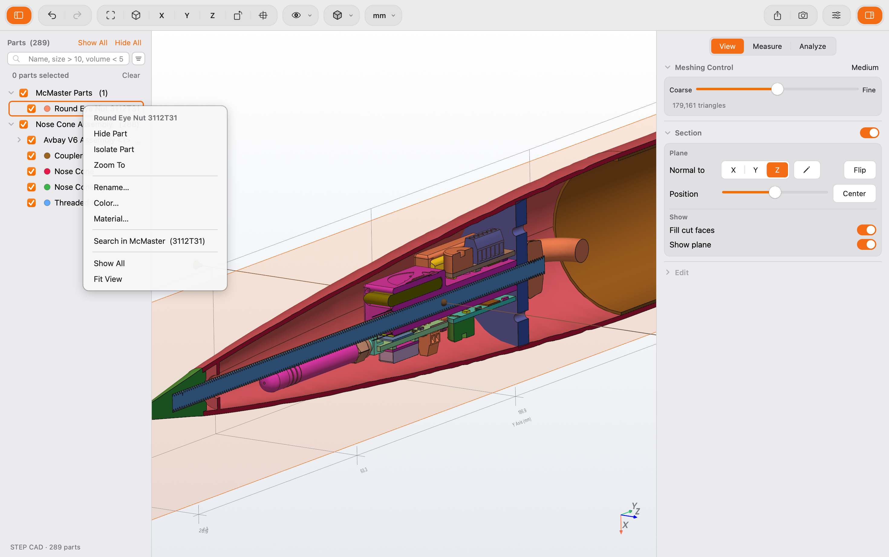
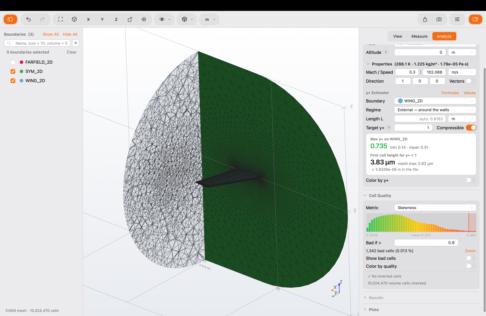
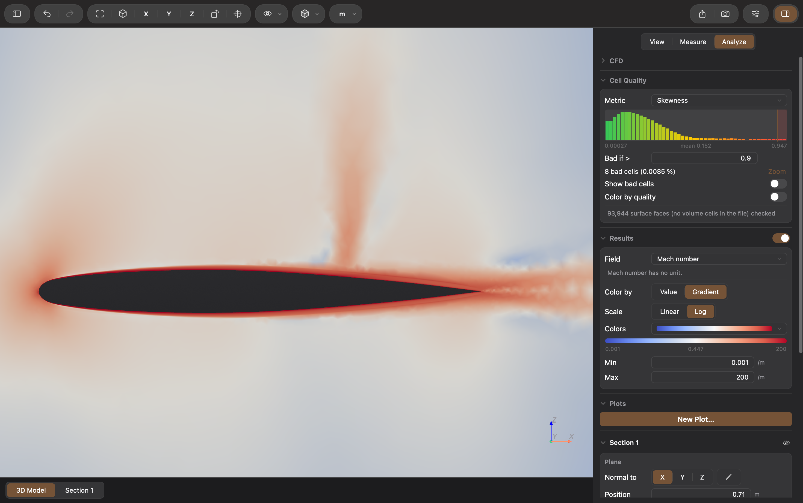
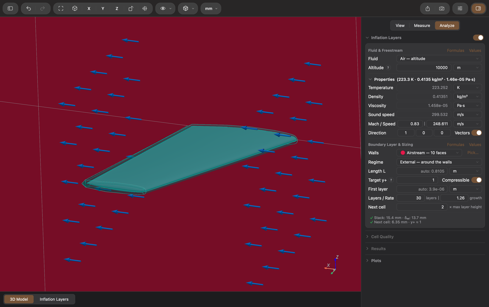
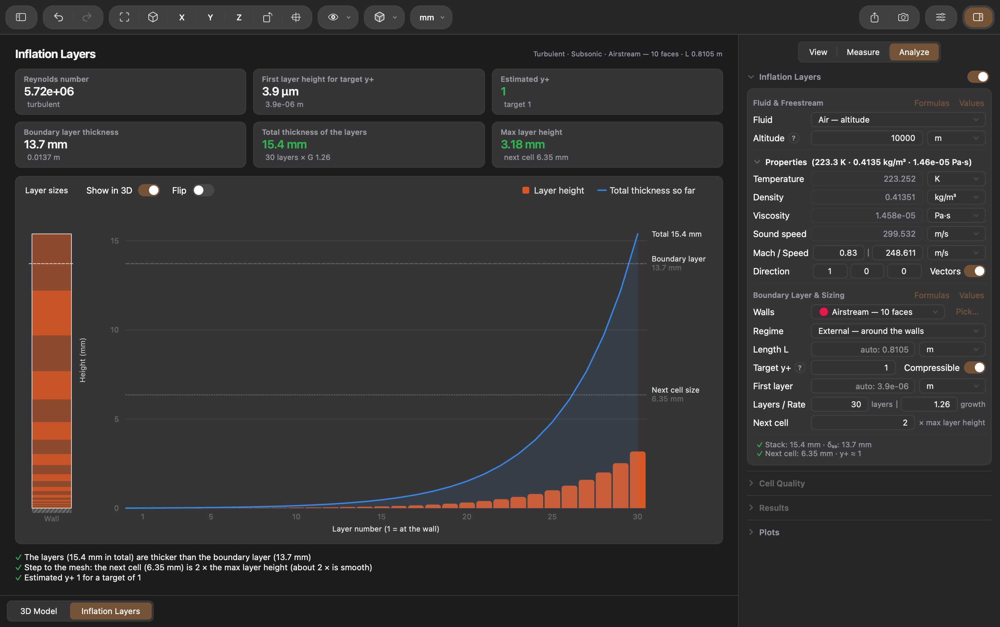

# Mesh Viewer

A fast, native macOS viewer for **CAD assemblies**, **CFD meshes** and **simulation
results**. Double-click a STEP, CGNS, UGRID, .msh, STL or DXF file and look inside:
cut it, measure it, color it by its results, and size its inflation layers.



## Small AI Disclaimer

I just wanted to make it clear here: I am a mechanical engineer. I have studied
physics and mechanical engineering, not software engineering. Therefore yes, this
program has entirely been made using Claude Opus 5.5. I was tired of not having
a quick and simple way to preview my CAD/mesh files on my MacBook, so I 'made' this
program. I chose each functionalities it should have, but I didn't implement them
myself. I am sharing this work as I liked how it ended up looking and felt like
others could benefit from it.

## What it does

- **CAD assemblies**: STEP / IGES / BREP read with OpenCASCADE: the assembly tree,
  colors and materials, exact areas and volumes. Sort and filter parts by name, size or
  volume; hide, isolate, recolor, rename; choose how finely each file is meshed.
- **Meshes**: CGNS (polyhedra too), UGRID, Gmsh and Fluent .msh, 2D or 3D, with their
  named boundaries. The section plane cuts the volume cells; Cell Quality finds the
  skewed, stretched and inverted ones.
- **CFD results and plots**: FUN3D / Tecplot results on the boundaries, with the usual
  fields and their units, gradients, linear or log color scales, and section plots in
  their own tabs.
- **Inflation Layers**: y+ and first-cell height from the flow, the layer stack to
  scale on the wall, the total thickness drawn in 3D over the walls, and the settings
  exported for OpenFOAM, Fluent, STAR-CCM+ or Pointwise.
- **Measure and select**: distances, angles, areas, volumes; **Select ▾** picks nodes,
  edges, faces or cells and **Measure Selected** gives their numbers (a circle's
  radius, a face's normal, a cell's quality). DXF drawings show their text, dimensions
  and arrowheads.
- **A real Mac app**: menu bar, Undo / Redo for everything (the camera too), Settings,
  sheets, a customizable toolbar, light and dark mode, your accent color, smooth
  trackpad zoom toward the pointer, VoiceOver.

<p align="center">
  
  
</p>
<p align="center">
  
  
</p>

## Formats

| Kind | Formats |
|------|---------|
| Mesh | CGNS `.cgns` (MIXED, polyhedral NGON / NFACE cells too), UGRID `.lb8/.b8/.lb4/.b4.ugrid` (boundary names from `.mapbc`), Gmsh and Fluent `.msh` (2D or 3D, found from the file) |
| Results | Tecplot ASCII `.dat` (FUN3D `project_tec_boundary.dat`: the boundaries with their solution) |
| CAD, exact geometry | STEP `.step/.stp`, IGES `.iges/.igs`, BREP `.brep/.brp` |
| CAD, triangulated | STL `.stl`, OBJ `.obj`, PLY `.ply`, glTF `.gltf/.glb`, VRML `.wrl/.vrml` |
| Drawing (2D) | DXF `.dxf`: lines, arcs, circles, splines, text, dimensions, arrowheads (solids) and blocks, one part per layer |

Native SolidWorks, CATIA, NX, Creo, Inventor, Parasolid (`.x_t`), ACIS (`.sat`)
and JT files are closed formats: export STEP (best) or IGES from those programs.

Results: Tecplot ASCII only (not binary `.plt` / `.szplt`); with several time steps,
the last one is shown.

## Download

Get the latest **`Mesh Viewer <version>.dmg`** from the
[Releases page](../../releases/latest), open it and drag **Mesh Viewer** onto
**Applications**.

> **First launch:** the app isn't notarized by Apple (that needs a paid developer
> account), so macOS blocks it the first time. Try to open it once, then go to
> **System Settings → Privacy & Security** and click **Open Anyway**. You only
> need to do this once.

The app in the .dmg is built for **Apple Silicon** Macs running macOS 13 or later.
On an Intel Mac, build it from source (below).

## Build from source

You need Python 3.12 or 3.13 from Homebrew or python.org. py2app doesn't support
pyenv or conda Pythons, or Python 3.14 yet.

```bash
brew install python@3.13
git clone https://github.com/mdefontenay/MeshViewer.git
cd MeshViewer
./build_app.sh            # quick build, installed in /Applications
```

- `./build_app.sh` creates `.venv`, installs `requirements.txt`, builds the app
  and installs it. This quick build runs the code in this folder, so keep the
  folder where it is. After editing the code, just reopen the app.
- `./build_app.sh --standalone` builds a self-contained app (~1 GB) that can be
  copied to another Mac.
- `./make_dmg.sh` builds the self-contained app, checks it (`--selftest`) and
  packs `~/Downloads/MeshViewer-build/dist/Mesh Viewer <version>.dmg` (its window
  layout is written by `dmgbuild`, installed in the build environment the first time).
- Heavy files (Python environment, app, .dmg) go to `~/Downloads/MeshViewer-build`,
  not the project folder; choose another place with `MESHVIEWER_WORK=/path`.
- Run without building: `.venv/bin/python mesh_viewer.py file.step`

## Already have Python? Run it without the 1 GB app

The self-contained app is big because it carries its own copy of Python, Qt,
VTK and OpenCASCADE (I liked the self-contained aspect). If you already have Python with these packages, you don't
need any of that.

**1. Install what's missing:**

```bash
pip install numpy pyvista pyvistaqt PySide6 h5py cadquery-ocp
```

`cadquery-ocp` is only needed for STEP / IGES / BREP files, and `h5py` only
for CGNS files.

**2. Run it:**

```bash
git clone https://github.com/mdefontenay/MeshViewer.git
cd MeshViewer
python mesh_viewer.py path/to/file.step
```

**Optional: a small app in /Applications that uses your Python.** It gives
you the Dock icon and double-click-to-open, but only weighs a few MB because it
uses your installed packages. This needs Python 3.12 or 3.13 from Homebrew or
python.org:

```bash
python3.13 -m venv --system-site-packages .venv   # reuse your packages
./build_app.sh                                    # quick build, no re-download
```

Keep the MeshViewer folder where it is: this app runs the code from it.

## More

How the code fits together, and where to change what: [ARCHITECTURE.md](ARCHITECTURE.md).
Every version: [CHANGELOG.md](CHANGELOG.md).

## Credits

Made by **Matthieu de Fontenay**, built with Claude Opus 5.5.

Built on [PyVista](https://pyvista.org) / [VTK](https://vtk.org),
[Qt for Python (PySide6)](https://doc.qt.io/qtforpython/),
[OpenCASCADE](https://dev.opencascade.org) (via
[cadquery-ocp](https://github.com/CadQuery/OCP)), [h5py](https://www.h5py.org)
and [NumPy](https://numpy.org).

## License

[MIT](LICENSE) © 2026 Matthieu de Fontenay
